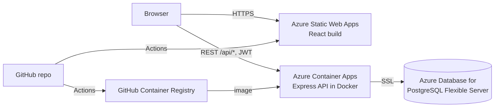

# DevConnect — Developer Portfolio & API Platform

DevConnect is a full-stack web platform where developers create a public portfolio (bio, skills, links) and publish blog posts written in Markdown. Visitors can browse developers, filter by skill, search posts and read them with syntax-highlighted code.

**Stack:** React 18 · HTML5 · CSS3 (Flexbox/Grid) · Node.js/Express · PostgreSQL · Docker · Azure · GitHub Actions

> Live demo: `https://<your-app>.azurestaticapps.net` (fill in after deploying)
> API: `https://<your-api>.azurecontainerapps.io/api/health`

---

## Features

**Frontend (React + CSS3)**
- Client-side routing with React Router: home, posts feed, post pages (`/posts/:slug`), developer directory, portfolio pages (`/u/:username`), dashboard, editor, settings
- Markdown rendering with GitHub-flavoured Markdown (tables, task lists) and code highlighting; raw HTML is not rendered, so posts are safe from script injection
- Split-pane editor with live preview; drafts and publishing
- Hand-written CSS with custom properties, Flexbox and Grid layouts, responsive down to phone width, automatic dark mode, keyboard focus styles, reduced-motion support

**Backend (Express + PostgreSQL REST API)**
- JWT authentication with bcrypt-hashed passwords and rate-limited login
- User profiles (CRUD for your own profile), developer search and skill filter
- Blog management: create, edit, delete, publish/unpublish, tags, search, pagination
- Ownership checks (you can only edit your own posts), drafts hidden from other users
- Parameterised SQL everywhere (no SQL injection), Helmet security headers, CORS allow-list
- Auto-migration on startup, health-check endpoint, graceful shutdown
- Integration test suite (Node test runner) against a real PostgreSQL database

**DevOps**
- Dockerfiles for API and web, `docker-compose` for one-command local setup
- GitHub Actions pipelines: test → build Docker image → push to GitHub Container Registry → deploy to Azure Container Apps; React build → deploy to Azure Static Web Apps

---

## Architecture



## Database schema

| Table | Key columns |
| --- | --- |
| `users` | `id`, `username` (unique), `email` (unique), `password_hash`, `name`, `headline`, `bio`, `location`, `avatar_url`, `website`, `github`, `linkedin`, `skills TEXT[]`, timestamps |
| `posts` | `id`, `author_id → users.id` (cascade delete), `title`, `slug` (unique), `summary`, `content` (Markdown), `tags TEXT[]`, `published`, timestamps |

Indexes on `posts.author_id`, `posts.created_at` and a GIN index on `posts.tags`. See [`backend/src/db/schema.sql`](backend/src/db/schema.sql).

## API reference

Base URL: `http://localhost:4000/api`. Send `Authorization: Bearer <token>` for routes marked 🔒.

| Method | Endpoint | Description |
| --- | --- | --- |
| GET | `/health` | API and database status |
| POST | `/auth/register` | Create account `{username, email, password, name}` → `{token, user}` |
| POST | `/auth/login` | Log in with email or username `{login, password}` → `{token, user}` |
| GET 🔒 | `/auth/me` | Current user |
| GET | `/users?search=&skill=&page=&limit=` | Developer directory |
| GET | `/users/:username` | Public profile and published posts |
| PUT 🔒 | `/users/me` | Update own profile |
| GET | `/posts?q=&tag=&author=&page=&limit=` | Published posts feed |
| GET | `/posts/tags` | Popular tags |
| GET 🔒 | `/posts/mine` | Own posts including drafts |
| GET | `/posts/:slug` | One post (drafts only visible to the author) |
| POST 🔒 | `/posts` | Create post `{title, content, summary?, tags?, published?}` |
| PUT 🔒 | `/posts/:id` | Update own post |
| DELETE 🔒 | `/posts/:id` | Delete own post |

## Project structure

```
devconnect/
├── backend/                 Express REST API
│   ├── src/
│   │   ├── app.js           Express app, middleware, routes
│   │   ├── server.js        Startup: wait for DB, migrate, listen
│   │   ├── config.js        Environment variables
│   │   ├── db/              Pool, schema.sql, migrate, seed
│   │   ├── middleware/      JWT auth, error handling
│   │   └── routes/          auth, users, posts
│   ├── tests/api.test.js    Integration tests
│   └── Dockerfile
├── frontend/                React (Vite) app
│   ├── src/
│   │   ├── pages/           Route components
│   │   ├── components/      Layout, Markdown, shared UI
│   │   ├── api/client.js    Fetch wrapper
│   │   ├── context/         Auth state
│   │   └── styles.css       All styling (Flexbox/Grid)
│   ├── public/staticwebapp.config.json   SPA routing on Azure
│   ├── nginx.conf
│   └── Dockerfile
├── .github/workflows/       CI/CD pipelines
├── docker-compose.yml
└── SETUP_GUIDE.md           Step-by-step setup and Azure deployment
```

## Run locally

Requires [Docker Desktop](https://www.docker.com/products/docker-desktop/).

```bash
docker compose up --build
# optional: add a demo user (demo / demo12345) and sample posts
docker compose exec api node src/db/seed.js
```

Open http://localhost:8080 (API on http://localhost:4000).

For development with hot reload and how to run the tests, see [SETUP_GUIDE.md](SETUP_GUIDE.md).

## Environment variables

| Backend (`backend/.env`) | Purpose |
| --- | --- |
| `DATABASE_URL` | PostgreSQL connection string |
| `DB_SSL` | `true` on Azure, `false` locally |
| `JWT_SECRET` | Long random string for signing tokens |
| `JWT_EXPIRES_IN` | Token lifetime, default `7d` |
| `CORS_ORIGIN` | Comma-separated frontend URLs allowed to call the API |
| `PORT` | Default `4000` |

| Frontend (`frontend/.env`) | Purpose |
| --- | --- |
| `VITE_API_URL` | Base URL of the API, no trailing slash |

## Deployment

Full beginner walkthrough with every account and credential: **[SETUP_GUIDE.md](SETUP_GUIDE.md)**. Summary:

| Part | Azure service | Plan used |
| --- | --- | --- |
| React frontend | Azure Static Web Apps | Free |
| API (Docker) | Azure Container Apps | Consumption, monthly free grant, scales to zero |
| Database | Azure Database for PostgreSQL Flexible Server | B1ms, free 750 h/month for 12 months |
| Image registry | GitHub Container Registry | Free for public images |
| CI/CD | GitHub Actions | Free |
